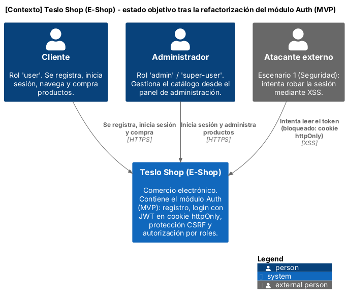
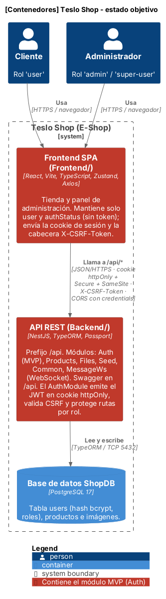
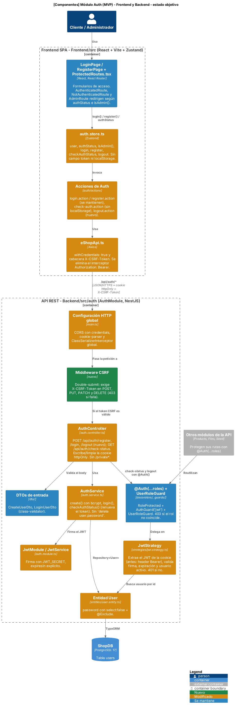
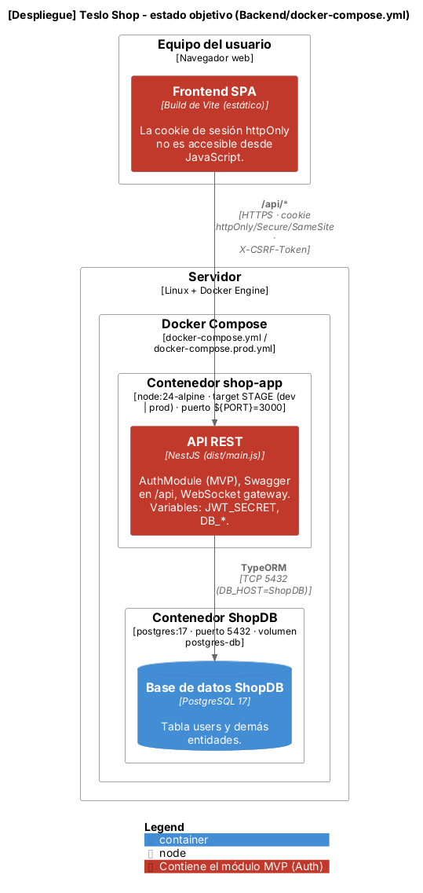

# Diagramas C4 – Versión 1 (estado objetivo del módulo Auth / MVP)

Los diagramas muestran cómo quedará el sistema **después** de la refactorización.
Están alineados con los ADR de `docs/adr/` (0001 a 0004), con la tabla de componentes de
`docs/arquitectura.md` y con los escenarios de calidad de la Semana 8.

| Nivel | Fuente editable | Exportado |
|---|---|---|
| 1. Contexto | `fuentes/01-contexto.puml` | `exportados/01-contexto.png` / `.svg` |
| 2. Contenedores | `fuentes/02-contenedores.puml` | `exportados/02-contenedores.png` / `.svg` |
| 3. Componentes – Módulo Auth (Frontend y Backend) | `fuentes/03-componentes-auth.puml` | `exportados/03-componentes-auth.png` / `.svg` |
| 4. Despliegue (Docker Compose) | `fuentes/04-despliegue.puml` | `exportados/04-despliegue.png` / `.svg` |

`fuentes/_estilos.iuml` contiene los colores compartidos.

## 1. Contexto


## 2. Contenedores


## 3. Componentes – Módulo Auth (Frontend y Backend)


## 4. Despliegue


## Convenciones de color
- **Rojo** (contenedores): contienen el módulo MVP (Auth).
- **Verde**: componente nuevo.
- **Naranja**: componente modificado.
- **Azul**: componente que se mantiene.

Son los mismos estados de la columna "Estado" de `arquitectura.md`.

## Qué cambio muestra cada diagrama
| Cambio visible | ADR | Problema (Semana 3) | Atributo (Semana 8) |
|---|---|---|---|
| JWT en cookie httpOnly/Secure/SameSite; `JwtStrategy` lee la cookie; `auth.store.ts` sin token ni localStorage; `eShopApi.ts` con `withCredentials` y sin `Authorization: Bearer` | 0004 | JWT en localStorage | Seguridad (Escenario 1) |
| Middleware CSRF (double-submit, `X-CSRF-Token`) y CORS con credentials en `main.ts` | 0004 | Riesgo CSRF al usar cookies | Seguridad (Escenario 1) |
| `POST /api/auth/logout` y `logout.action.ts` (JS ya no puede borrar la cookie) | 0004 | JWT en localStorage | Seguridad (Escenario 1) |
| `@Exclude` en `User.password` + `ClassSerializerInterceptor` global; `AuthService` sin `delete user.password` | 0002 | Exclusión manual de password | Mantenibilidad / Seguridad (Escenario 2) |
| `AuthController` sin `/private`, `/private2`, `/private3`; `@Auth(...roles)` como único mecanismo | 0003 | Endpoints de prueba en producción | Seguridad / Mantenibilidad |
| Componentes inyectables y aislados, verificables con Jest/Supertest y Vitest | 0001 | Ausencia de pruebas | Testabilidad (Escenario 3) |

Las pruebas (ADR-0001) no aparecen como componentes porque no forman parte del sistema en ejecución.

## Cómo regenerar
```bash
cd docs/diagramas/fuentes
java -jar plantuml.jar -charset UTF-8 -tpng -o ../exportados 0*.puml
java -jar plantuml.jar -charset UTF-8 -tsvg -o ../exportados 0*.puml
```
También se pueden editar en la extensión PlantUML de VS Code. Usan C4-PlantUML incluido en
PlantUML (`!include <C4/...>`), sin descargas extra.
